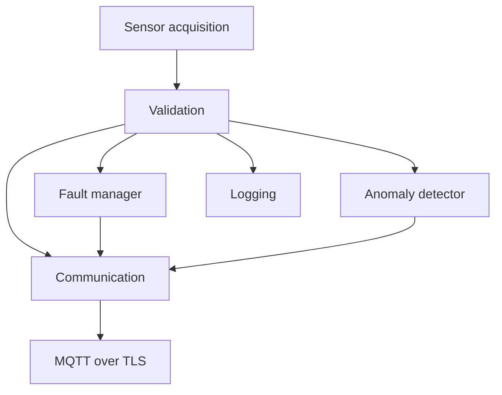

# Architecture

The original ESP32 runs ESP-IDF v6.1 and six FreeRTOS monitoring tasks.

| Task | Priority | Stack bytes | Responsibility |
|---|---:|---:|---|
| Acquisition | 4 | 4096 | Read temperature, vibration window and current proxy |
| Validation | 3 | 4096 | Validate and distribute independent record copies |
| Fault | 2 | 4096 | Threshold persistence, hysteresis and recovery |
| AI | 2 | 4096 | Statistical distance and anomaly flag |
| Logging | 1 | 4096 | Validated measurement and quality logs |
| Communication | 1 | 4096 | Match results and publish telemetry |

Fault thresholds and the statistical model are separate decisions; an AI anomaly does not directly change the fault state. MQTT connection state also does not directly change that state. Additional connection and optional OTA worker tasks exist outside the six monitoring tasks.

Acquisition owns driver handles. DS18B20 uses a single-device 1-Wire bus on GPIO4 through UART1; console UART0 remains separate. The blocking temperature conversion is followed by a 16-sample MPU6050 window (nominal 10 ms spacing), then eight ADC reads. The record timestamp marks completion; measurements are not simultaneous. The 1000 ms acquisition schedule logs overruns. On input failures values remain NAN and validation rejects them; no synthetic fallback replaces failed measurements. The sensor_sim helper initializes shared record fields, but all three measurement values are overwritten by driver outputs.

The raw queue holds eight records with zero-wait sends and drop-new overflow. Validation fans out copies to three eight-record queues with up to 100 ms wait per send. Three one-record mailboxes hold the latest sample, fault result and AI result. Communication matches sequence numbers and checks quality/freshness before publishing; intermediate records can be skipped. Maximum accepted age is 500 ms inclusive; receive timeouts are 3000 ms. Records are copied by value, never as pointers to local stack storage. Startup allocation failures abort.

The fault state machine uses three warning samples, two fault samples, and five clear samples to RECOVERY followed by five more to NORMAL. Invalid inputs preserve the current state and reset persistence counters. A sequence gap also resets counters. There is no continuous independent task-crash recovery supervisor. Thresholds are demonstration settings, not equipment ratings.

TLS waits for SNTP clock synchronization and validates the broker certificate/hostname with the ESP certificate bundle. MQTT uses QoS 1 and retained=false. The shared public broker has no device authentication or private topic ACLs. The optional OTA worker writes the inactive partition and requires candidate checks and post-boot health confirmation; it is disabled in the default configuration.

The pipeline has host-tested logic and observed simulator behavior. Those checks do not establish worst-case deadlines, waveform fidelity, CPU utilization, or physical-machine safety.
